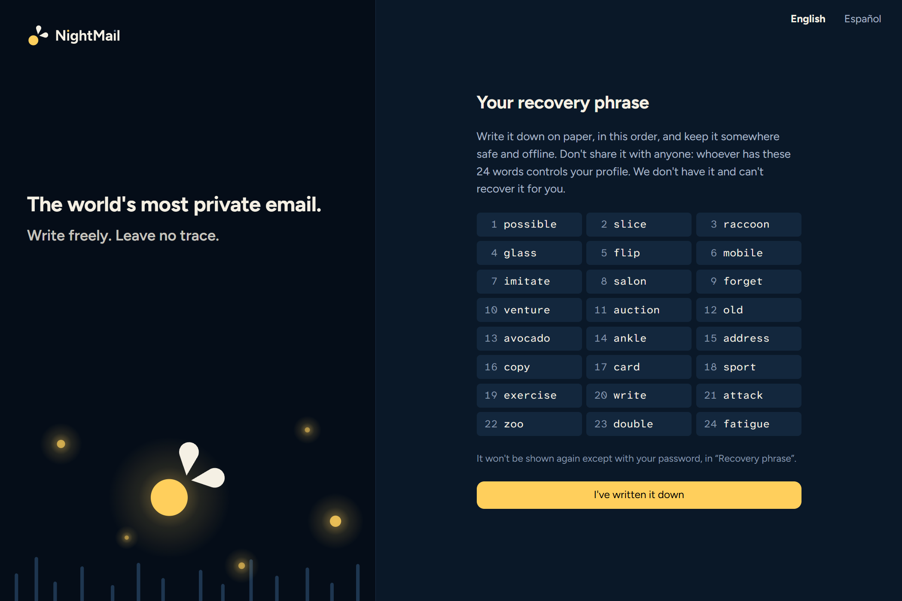
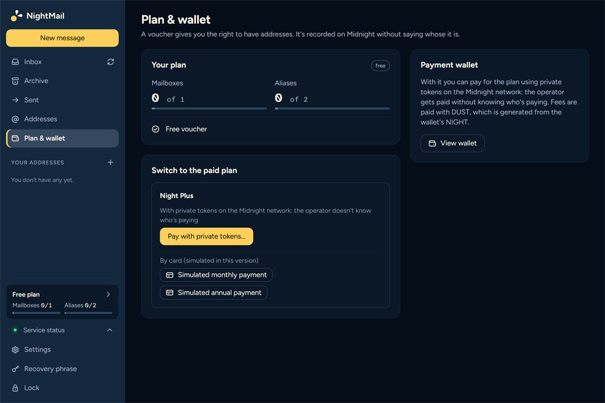
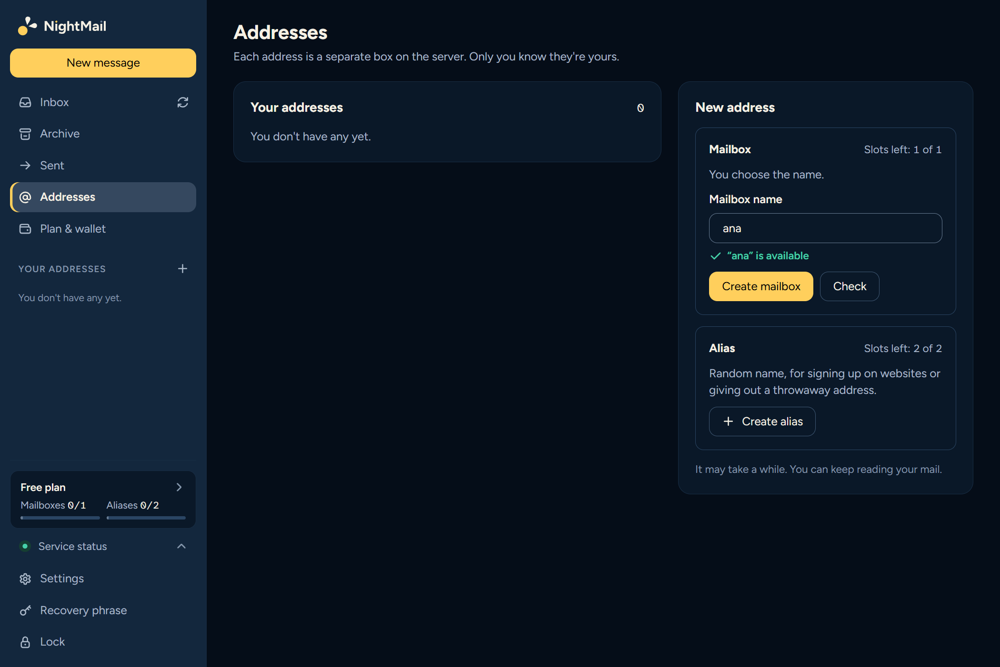
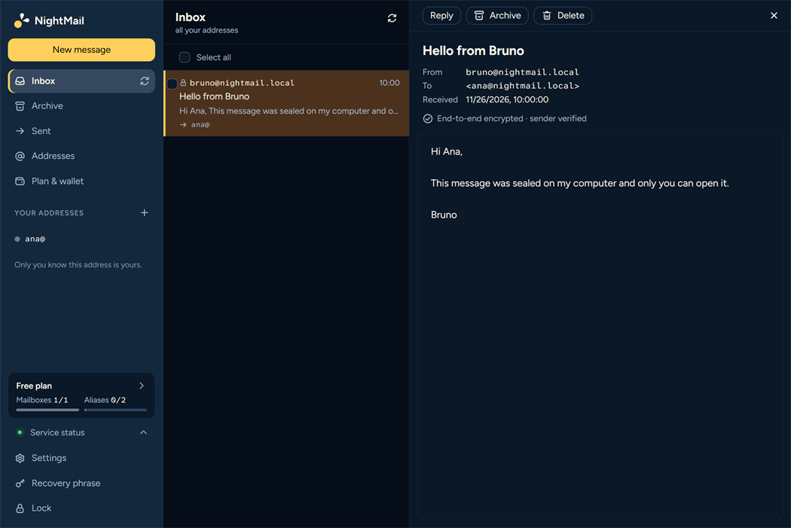

<h1 align="center">
  <picture>
    <source media="(prefers-color-scheme: dark)" srcset="design/brand/logo-lockup-horizontal-dark.svg">
    
  </picture>
</h1>

<p align="center"><b>Not even we can connect the dots.</b></p>

## What NightMail is

NightMail is a private email provider built on [Midnight](https://midnight.network).

- **No account:** your profile is a 24-word phrase that never leaves your device.
- **Independent addresses:** each address (a mailbox with the name you choose or a random alias) is a separate mailbox.
- **Anonymous credential:** the right to have addresses is a credential on Midnight. Each address spends one slot from your plan's quota, which is proven with a zero-knowledge proof.
- **End-to-end encrypted mail:** between NightMail addresses, every message is encrypted on your device before it leaves and only its recipient can open it. Nobody along the way can read it, not even the server operator. And whoever receives it can be sure of who wrote it.

## NightMail compared with other private providers

With Proton and Tuta, your data and your keys sit on their server and you have to trust them. It is like leaving your funds on an exchange. With NightMail you keep them yourself, like in a cold wallet.

| | **NightMail** | Proton Mail | Tuta |
|---|---|---|---|
| **Who controls your keys** | **You, on your device** | Them, on their server | Them, on their server |
| **Getting started** | **24 words. No account** | Create an account | Create an account |
| **Your addresses** | **Independent: nothing links them** | A pack under one account | A pack under one account |
| **What the server sees** | **Only which mailbox it goes to** | Sender, recipient, subject, time and IP | Sender, recipient and dates |
| **Paying** | **No account to tie it to** | Tied to your account | Redeemed in your account |
| **Hidden IP** | **By default: built-in Tor, one circuit per address** | Optional: external Tor, set up on your own | Optional: external Tor, set up on your own |

**Your mail, your keys.**

Data on Proton and Tuta was taken from their official pages on 15 November 2026 and may change.

## What Midnight makes possible

Private providers protect what your mail says. Midnight lets NightMail also protect who is behind it.

- **No account.** Elsewhere, you create one. In NightMail, you start from 24 words, and each new address carries a zero-knowledge proof, made on your computer, that you are allowed to create it, without revealing who you are.
- **Nothing links your addresses.** With other providers, your addresses and aliases sit together under one account. In NightMail, each address spends a slot of your plan through a one-time nullifier, so the contract enforces your quota without knowing which addresses belong together.
- **Paying with no account behind it.** Other providers tie the payment to your account. NightMail is paid with a Midnight shielded token that hides which wallet paid, and the contract registers the plan in the same transaction.
- **Keys only you hold.** Proton and Tuta keep your keys on their servers. Here, everything comes from your 24 words, and you keep them wherever you like. Public keys are registered on Midnight, and NightMail reads them from there.


## Project status

### Working today

- Create a profile (24 words and a password) and restore it on a clean computer: mailboxes, aliases and received mail are recovered.
- Get a plan: free (1 mailbox and 2 aliases) or Night Plus, the paid one (5 mailboxes and 20 aliases in total). Payment is simulated or made with the NightMail token, a shielded token on the Midnight network.
- Create mailboxes (with a custom name) and random aliases, **with no way to link them to each other**.
- **Receive mail:** it is downloaded per address and read safely (sanitized and isolated HTML, remote images blocked, links checked before they are opened).
- **Send mail** between NightMail addresses, end-to-end encrypted. On arrival, the app checks that the message was signed by the address shown as sender and marks it with a badge (verified sender). This way nobody can impersonate another NightMail address.
- **Several profiles on the same computer.**
- **The NightMail token** is a shielded test currency with no real value for now. Anyone can request it to simulate a private payment.

### In progress

- **Preprod deployment.** We are running the tests to deploy NightMail on preprod. The server and the payer already run there. The desktop app is the part left to connect.
- **Built-in Tor.** We are integrating [Arti](https://arti.torproject.org), the Tor Project's Rust implementation, into the NightMail Rust core, with a separate circuit for each address.

### Planned

- Protection against timing correlation, so that addresses created close together cannot be grouped: random waits and decoy traffic.
- Sending to outside addresses, to several recipients per message and with attachments. Today sending is only possible between NightMail addresses, to one recipient and without attachments.
- Real deletion: today abandoning an address only hides it in your app. Deleting it from the server, and deleting messages on the server, will come later.
- **Proof server in the cloud.** Today the zk proofs are generated by a Midnight proof server running on your own computer. We will host one in the cloud and let you choose between a local one and one hosted by a third party.
- **Transaction sponsorship.** An option, chosen by the user, for NightMail to sponsor the transactions the user needs.
- A redesign of aliases and post-quantum cryptography.

## Get started

NightMail runs on a local Midnight network in Docker.

### Windows

You need Git, Node.js 24 and Docker Desktop (running, or it is started for you).

```powershell
git clone https://github.com/Leyenda95/nightmail.git
cd nightmail
npm run demo:windows
```

It checks what is missing and tells you how to install it, starts the local Midnight network and the NightMail backend (mail server and payer) in Docker and opens the app. The first run builds the backend image, compiles the contracts and deploys them, which takes several minutes. Run it again any time: it reuses everything and does not open a second window. The app is downloaded prebuilt, or built locally with `npm run demo:windows -- -Build`. To stop it, run `docker compose -f infra/backend/docker-compose.yml stop` and then `docker compose -f infra/devnet/docker-compose.yml stop`.

To start the local demo from scratch, run `docker compose -f infra/backend/docker-compose.yml down -v` and then `npm run demo:windows` again. It deletes the backend's keys and mailboxes of the local demo, and the next run deploys new contracts.

Alternative with WSL (Ubuntu) instead of the backend in Docker: clone to `C:\nightmail`, run `bash /mnt/c/nightmail/tools/dev/demo-wsl.sh` in an Ubuntu terminal and keep it open, then run `npm run demo:windows -- -Wsl` on Windows.

### Linux or WSL

You need Git, Node.js 24 and Docker.

```bash
git clone https://github.com/Leyenda95/nightmail.git
cd nightmail
npm run demo
```

It checks what is missing and tells you how to install it, sets everything up the first time (this takes a while, because it compiles the contracts and the app) and opens the app. Run it again any time. To stop, run `bash tools/dev/down.sh`.

### First steps in the app

1. **Create a profile.** Click **Create my recovery phrase**, choose a password and write the 24 words down on paper. Then click **I've written it down**.

   
2. **Get the free plan.** In **Plan & wallet**, click **Request the free plan**.

   
3. **Create an address.** Click **New address**, then **Create mailbox** (after you choose a **Mailbox name**) or **Create alias**. The proof is made on your computer, so it may take a while.

   
4. **Send a message.** Create a second address, click **New message**, write to it and click **Send**. It arrives marked **End-to-end encrypted · sender verified**.

   

## Limitations

- NightMail is alpha software for a hackathon. Do not use it for important mail. See [SECURITY.md](SECURITY.md).
- The desktop app runs only against the local network for now.
- There are no optimized builds or installers yet (the prebuilt app is a debug build), and the Windows app is not signed.
- The NightMail token, NIGHT and DUST used here are test currencies with no real value. The card payment and the CAPTCHA are simulated.

For what is in progress and planned, see [Project status](#project-status).

## How it works

### Components

| Piece | Where | What it does |
|---|---|---|
| **`NightMailRegistry` contract** | `contracts/src/NightMailRegistry.compact` (Compact, on Midnight) | The registry of plans and addresses. It stores the issued plans, the slots already spent and the public keys of each address. Its header summarizes what is public and what stays private. |
| **`TestToken` contract** | `contracts/src/TestToken.compact` | The test NightMail token, with a faucet. Only for test networks: it never backs a real payment. |
| **Mail server** | `apps/server` (Node and TypeScript) | Receives mail over SMTP, stores it encrypted for each address, serves the API the app downloads mail from and the delivery API between NightMail addresses, issues plans and forwards the app's proofs to the chain (relayer), so you pay no fees for creating addresses. It keeps its own copy of the registry, read from the chain. |
| **Payer** | `apps/server/src/bin/operator-wallet.ts` | A separate process, the only one holding the operator wallet and paying the network fees. The server asks it for payments over a local channel. This way the wallet seed is not in the process that faces the internet. |
| **Desktop app** | `apps/desktop` ([Tauri](https://tauri.app): Rust core and React interface) | The core stores your keys encrypted with your password, downloads and decrypts mail, keeps it in an encrypted database, and signs and encrypts what you send. The interface only displays and has no access to the network or to files. |
| **Midnight helper process** | `apps/midnight-sidecar` (Node and TypeScript) | Launched by the app, it talks to it over standard input and output, opening no ports. It reads the contract state, builds the zero-knowledge proofs with the local proof server and runs the wallet used to pay for the plan. It stores nothing in the clear: the app gives it the wallet seed and the key that encrypts the wallet state it saves. While the wallet is open, its keys are in the helper's memory. |
| **Shared packages** | `packages/core-ts`, `packages/midnight`, `packages/test-vectors` | Server-side cryptography (mailbox encryption, signatures, the mail format between addresses), contract utilities (the same calculations as the chain) and test vectors shared by Rust and TypeScript so both implementations match byte for byte. |
| **Tools** | `tools/dev`, `tools/demo-mailer`, `tools/demo-seed`, `infra/devnet` | Scripts to start, build and open the app, sample mail over SMTP, demo network setup and the local Midnight network in Docker (node, indexer and proof server). |

```
 Your computer                                      NightMail operator
┌───────────────────────────────────┐             ┌──────────────────────────────────┐
│ Desktop app (Tauri)               │   HTTP      │ Mail server                      │
│  React interface                  │◄───────────►│  Incoming SMTP                   │
│  Rust core: keys, encryption,     │             │  Mailbox and delivery API        │
│  encrypted database               │             │  Plan issuer                     │
│        │ stdio                    │             │  Relayer ──► Payer (operator     │
│  Midnight helper process          │             │              wallet)             │
│  (state, proofs, wallet)          │             └───────────────┬──────────────────┘
│        │                          │                             │
│  Local proof server               │                             │
└────────┼──────────────────────────┘                             │
         │ reads state and pays the plan                          │ sends transactions
         ▼                                                        ▼
┌───────────────────────────────────────────────────────────────────────────────────┐
│ Midnight: NightMailRegistry (plans and addresses) and TestToken (test currency)   │
└───────────────────────────────────────────────────────────────────────────────────┘
```

### How a plan is obtained

1. NightMail derives a new plan identifier from your 24 words.
2. **Free plan or simulated payment:** the app asks the server for the plan with that identifier, and the operator registers it in the contract. The server returns a signed receipt.
3. **Payment with the NightMail token:** you pay the exact price on Midnight with a private currency and the contract registers the plan in the same operation. The operator is paid without knowing who pays. The fees of that operation are paid with DUST, which the wallet's NIGHT generates.
4. In both cases only a fingerprint of the plan is left on the chain, and it does not say whose it is.

### How an address is created

1. The app proves with a zero-knowledge proof, generated on your computer, that it holds a plan with free slots, without saying which one.
2. It sends the proof to the operator's relayer, which pays the fee and sends it to the chain.
3. A named mailbox is created in two steps (reservation, then reveal of the name once the chain's clock is 30 seconds past the reservation) so that nobody watching the operation can get ahead and register the same name. An alias is created in one step, because its name comes from its own keys.
4. Each address has its own keys, derived from your 24 words, which is why restoring recovers all of them.

### Mail between NightMail addresses

1. To encrypt the message, the recipient's public key is needed. The app reads it directly from the chain's public registry, on your computer, and does not ask the NightMail server for it. This way that lookup reveals to nobody who you are going to write to.
2. It signs the message with your address's private key and encrypts it, signature included, with the recipient's public key. The date is the server's time, never your clock's, so that an offset in your clock cannot link your addresses.
3. It delivers it to the server anonymously: the delivery carries no signature and does not say who sends it. The server only sees an encrypted envelope padded to one of a few standard sizes, and stores it the same way as mail arriving over SMTP.
4. The recipient's app decrypts it, looks up the sender in the registry and checks the signature. If it matches, only someone holding that address's private key could have signed it, and the message carries the "verified sender" badge.

## Glossary

- **Plan:** how many addresses you can have. Free: 1 mailbox and 2 aliases. Night Plus: 5 mailboxes and 20 aliases.
- **Bono (voucher):** the record of one plan in the registry. The code and tools call it a bono; the app calls it a voucher. It does not say whose it is.
- **Slot:** one place in a plan's quota. Each address spends one.
- **Nullifier:** a public value that marks a slot as spent. It comes from your secret, so nobody can tell which plan it belongs to, and the same slot cannot be spent twice.
- **Address:** a **mailbox** (a name you choose) or an **alias** (a random name that comes from its own keys). Each one has its own keys, and its public keys are in the registry.
- **Reveal delay:** the 30 seconds of chain time a mailbox reservation waits before its name can be revealed. Whoever copies a name from a pending reveal would have to wait that long after its own reservation, so the first reveal lands first.
- **Relayer:** the part of the server that sends the app's proofs to the chain. The operator pays the fee.
- **Payer:** the separate process that holds the operator wallet and pays the network fees.
- **Sidecar:** the Midnight helper process the app launches (`apps/midnight-sidecar`).
- **Proof server:** the Midnight service that builds the zero-knowledge proofs. Here it runs on your computer, in Docker.
- **NIGHT and DUST:** NIGHT is Midnight's token. DUST is the resource that pays Midnight fees, generated by the NIGHT a wallet holds. On test networks both have no value.
- **NightMail token:** the test token (`TestToken`) used to pay for Night Plus. It has no value.

## For developers

### Repository layout

| Folder | What it holds |
|---|---|
| [`apps/desktop`](apps/desktop/README.md) | The desktop app: Rust core and React interface (Tauri). |
| [`apps/server`](apps/server/README.md) | The mail server and the payer, plus the `deploy-contracts`, `fund-night` and `send-night` commands. |
| [`apps/midnight-sidecar`](apps/midnight-sidecar/README.md) | The Midnight helper process: registry state, proofs and the payment wallet. |
| [`contracts`](contracts/README.md) | The `NightMailRegistry` and `TestToken` Compact contracts. |
| [`packages/core-ts`](packages/core-ts/README.md) | Server-side cryptography and the mail format between addresses. |
| [`packages/midnight`](packages/midnight/README.md) | Registry utilities shared by the server and the helper process. |
| [`packages/test-vectors`](packages/test-vectors/README.md) | Test vectors shared by Rust and TypeScript, and the protocol spec. |
| [`infra/devnet`](infra/devnet/README.md) | The local Midnight network in Docker. |
| [`infra/backend`](infra/backend/docker-compose.yml) | The demo backend in Docker (mail server, payer and contract deployment), used by `npm run demo:windows`. |
| [`tools/dev`](tools/dev) | Scripts to set up, start, build, open and stop everything. |
| [`tools/demo-mailer`](tools/demo-mailer/README.md) | Sends sample mail over SMTP. |
| [`tools/demo-seed`](tools/demo-seed/README.md) | Prepares the demo network (filler bonos). |
| [`design`](design) | Logo, fonts, icons, sounds and the color tokens of the app. |
| [`vendor/mail-parser-0.11.9`](vendor/mail-parser-0.11.9/README-NIGHTMAIL.md) | The mail parser used by the app, patched against hostile mail. |

### Run the tests

```bash
npm test               # unit tests of every package and the Rust core (cargo test)
npm run typecheck      # TypeScript in every package
npm run lint:rust      # clippy on the Rust core, warnings are errors
```

Run them after `npm run demo` (or the manual setup below): some packages need the compiled contracts. The slower suites need the local network running: `npm run test:devnet -w apps/server`, `npm run test:devnet -w apps/midnight-sidecar` and `npm run test:e2e -w apps/server` (the last one also needs the payer and the mail server).

### Manual setup

<details>
<summary>The steps <code>npm run demo</code> runs, one by one</summary>

The first time, on Linux or WSL:

```bash
npm ci                                   # dependencies of all packages
bash tools/vendor-base-styles.sh         # base stylesheet
npm run compile -w contracts             # contracts with ZK keys
npm run compile:sim -w contracts         # simulator version
npm run devnet:up                        # node, indexer and proof server in Docker; waits until healthy
NIGHTMAIL_NETWORK=undeployed npm run deploy-contracts -w apps/server -- --price 100
bash tools/dev/build.sh                  # builds the desktop app (debug version)
```

On the local network the operator wallet uses the public seed of the development network, which already has funds. The deployment saves the contract addresses in `.data/operator/undeployed/contracts.json`.

Every day:

```bash
bash tools/dev/up.sh                     # local network, payer and mail server
bash tools/dev/window.sh                 # opens the app with your profiles in .data/dev/perfiles
bash tools/dev/mail.sh name@nightmail.local   # sends sample mail to one of your addresses
bash tools/dev/down.sh                   # stops the payer and the server (add --devnet to also stop the network)
```

- `window.sh` keeps all your profiles in one folder, `.data/dev/perfiles` (the app adds and switches between them). `window.sh other-folder` opens the app with an empty folder in `.data/dev/profiles/other-folder`, for example to test restoring with the 24 words on a clean computer or to open two windows at once. Do not open two windows on the same folder at once.
- Logs are kept in `.data/dev/` (`payer.log`, `server.log`, `window.log` and `window-<folder>.log`).
- Mail on the local network uses the domain `nightmail.local` and enters over SMTP at `127.0.0.1:2525`.

Native Windows app by hand, only if you do not use `npm run demo:windows`. It expects a WSL copy at `~/nightmail` in the default WSL distribution, already set up as above.

1. Set up mirrored networking, so that the WSL ports answer on Windows: add `networkingMode=mirrored` under `[wsl2]` in `%UserProfile%\.wslconfig` and run `wsl --shutdown`. Install on Windows Node 24, Rust (MSVC) 1.90 or later, Visual Studio Build Tools, WebView2 and [Strawberry Perl](https://strawberryperl.com).
2. In the Windows copy, run `npm ci` and copy `vendor/base-styles` and `contracts/managed` into it from the WSL copy. In WSL, run `bash tools/dev/up.sh`.
3. On Windows, with the app closed:

```powershell
powershell -ExecutionPolicy Bypass -File tools\dev\build.ps1
powershell -ExecutionPolicy Bypass -File tools\dev\window.ps1
```

`window.ps1` reads the receipt key and the contracts from `~/nightmail` in the default WSL distribution (`-WslRepo` or `-Distro` to change it). Options: `-ProfilesDir` for the named folders, `-TargetDir` for the build folder.

</details>

### Configuration

Copy the template and fill in what you need:

```bash
cp .env.example .env
```

- `.env` only holds secrets and is not versioned. Today there is just one: `BLOCKFROST_PROJECT_ID`, needed on preprod.
- The remaining options (ports, domain, relayer and payer limits, plan issuer and app options) are read from the shell environment. `.env.example` lists them all with their default values.
- The desktop app needs `NIGHTMAIL_ISSUER_RECEIPT_KEY`, the fingerprint of the key the server signs receipts with. The server prints it on startup and the `tools/dev` scripts pass it automatically.

### Local network and preprod

| | Local network (`undeployed`) | Preprod |
|---|---|---|
| Purpose | Development, tests and demo | Pre-production network of Midnight |
| How it is chosen | `NIGHTMAIL_NETWORK=undeployed` | `NIGHTMAIL_NETWORK=preprod` (default value) |
| Node and indexer | Docker, `infra/devnet` | [Blockfrost](https://blockfrost.io), with `BLOCKFROST_PROJECT_ID` in `.env` |
| Operator wallet | Public development seed, with funds | New random seed in `.data/operator/preprod/`, which must be funded with test NIGHT from the preprod faucet |
| Contracts | Deployed with `deploy-contracts` | Deployed as a rehearsal |
| Desktop app | Yes | Not yet |

The operator data of each network (wallet seed, keys and state) is kept in `.data/operator/<network>/`, outside git. **Back up** from that folder `seed` (the operator wallet), `maintenance-key-registry` (without it, circuits cannot be added to the contract later) and `operator-sk` (without it, plans cannot be issued).

## Project resources

- [SECURITY.md](SECURITY.md): how to report a vulnerability privately, and what is in scope.
- [Protocol spec](packages/test-vectors/crypto/README.md): mailbox encryption, request signatures, key derivation and end-to-end mail, with test vectors.
- Each folder's README, linked in the [repository layout](#repository-layout).
- [Report a bug](https://github.com/Leyenda95/nightmail/issues/new/choose) through Issues, with the bug report template. Security problems go to the Security tab, never to a public issue.
- [mail-parser patch](vendor/mail-parser-0.11.9/README-NIGHTMAIL.md): what was changed in the mail parser and why.
